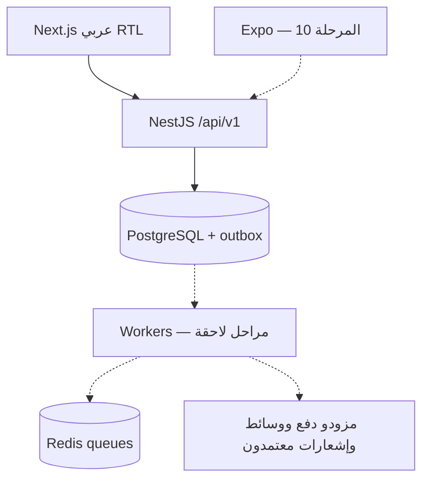

# ADR-000 — أساس Petra الجديد

الحالة: مطبق في المرحلة 00 · التاريخ: 2026-10-20.

## القرار

pnpm workspace، Node 24، TypeScript صارم، Next.js 16 للويب وNestJS 12 للنواة، PostgreSQL 17 وRedis 7 عبر Compose. المنصة modular monolith؛ لا microservices أو Kubernetes في البداية. حزم العقود لا تحتوي أسرارًا، ويقرأ الويب البيانات التجريبية عبر API ويحققها بمخطط Zod.

نحتفظ بخمس شخصيات؛ `clinic_member` عضوية ضمن مؤسسة وقد تحمل صلاحيات متعددة. storefront مرتبط بعيادة غير فارغة بمفتاح خارجي. لا حساب أو لوحة مستقلة للتاجر. `/demo` منطقة استكشاف تصميم موسومة ومغلقة دون flag صريح؛ ليست آلية هوية أو مصدر بيانات تشغيلية. المساحات التشغيلية المستقبلية منفصلة عنها.

المال سلسلة عشرية لعدد صحيح من الوحدات الصغرى، وIQD له ثلاث منازل؛ العرض باستخدام BigInt دون float. عقد الحدث المالي يتطلب دفترًا وعيادة ومفتاح منع التكرار وطابع UTC. **هذا عقد فقط، وليس ضمانًا للترحيل أو idempotency في قاعدة البيانات بعد.** ينفذ ledger كامل قبل أي معاملات فعلية.

## مخطط المكونات

الأسهم المنقطة عناصر مخطط لها؛ لا يوجد استهلاك outbox أو تكامل مزود حاليًا. readiness يختبر اتصال PG وRedis، ولا يدل وحده على صلاحية مخطط البيانات. migration وtest:db يفحصان المخطط بصورة منفصلة.

## البدائل والحدود

- لا ننقل واجهات Bolt أو SQL أو مفاتيح Supabase السابقة؛ تستخدم قائمة الوظائف والهوية اللونية كمرجع فقط.
- الحركة الحالية CSS tokens وانتقالات دخول/hover خفيفة؛ لا حاجة لمكتبة حركة قبل تعقيد التفاعلات. reduced-motion يعطل الحركة بالكامل.
- نستعمل خط IBM Plex Sans Arabic وManrope محليين من حزم Fontsource، ورسم SVG أصلي؛ لا نحتاج egress وقت العرض أو حقوق صور خارجية غير مؤكدة.
- mobile وworkers وobject storage تؤجل حتى وجود مستخدم فعلي لها وفق خارطة الطريق (mobile في 10، media في 06). المرحلة 00 لا تستلزم حفظ مرفقات؛ لا خدمة وهمية ترفع ملفات أو بيانات حساسة.
- اختيار ORM ومزود الهوية موثق قبل المرحلة 01. migration التأسيسية SQL صغيرة ومختبرة ولا تنفذ نظام auth مخصصًا.
- لا افتراضات عمولة أو ضرائب أو تغطية تأمين. ar-IQ وAsia/Baghdad وIQD افتراضات عرض قابلة للتغيير لاحقًا.

## نطاق البيانات المحلية

users، clinics، clinic_memberships، clinic_storefronts، outbox_messages، audit_events. لا endpoints لكتابة موارد خاصة بعد. لا تُعامل وجود هذه الجداول كنظام صلاحيات عامل. الفصل بين المستأجرين والصلاحيات يحتاج اختبارات مرحلة 01 وما بعدها قبل أي إتاحة خاصة.
