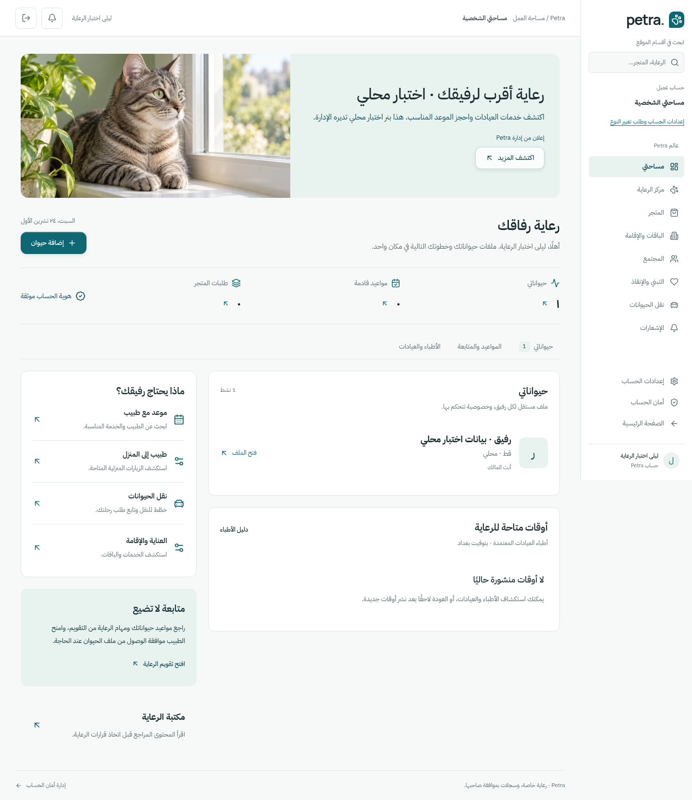
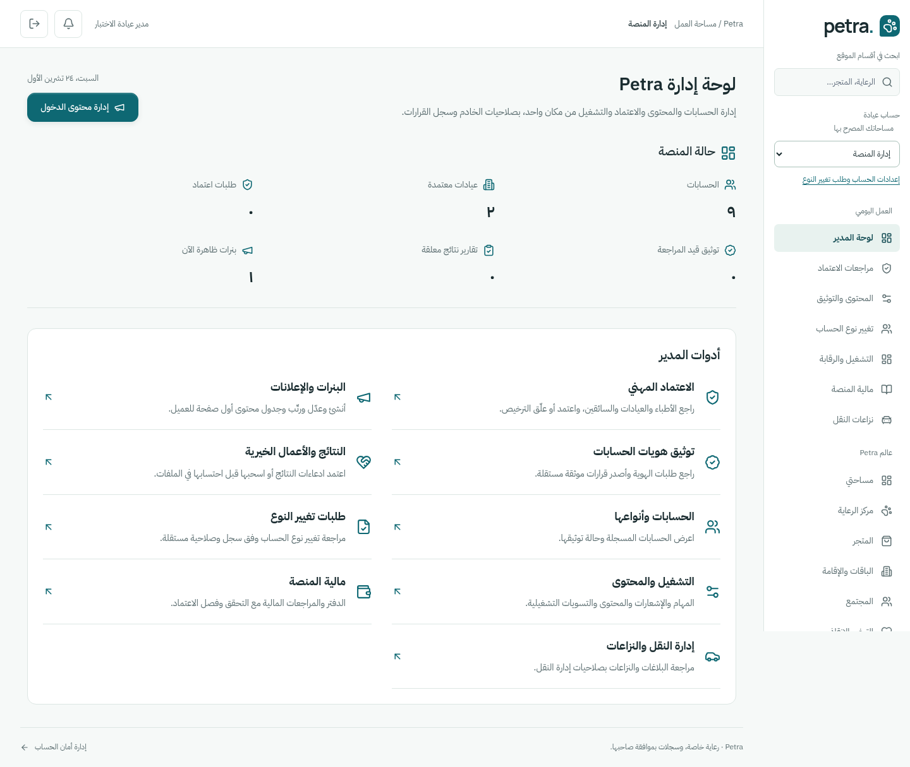
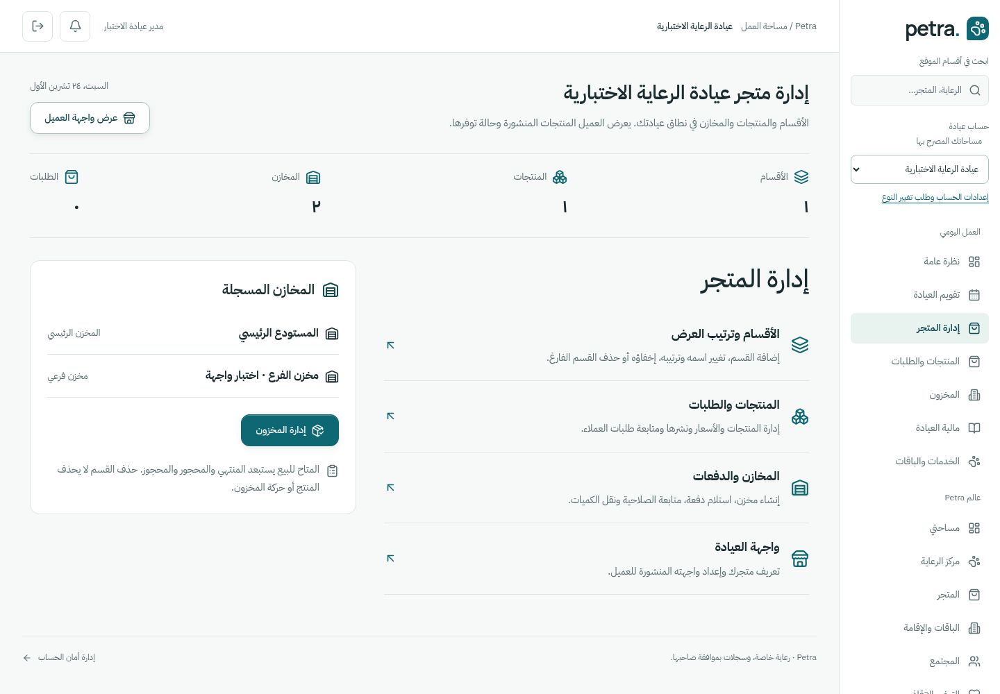
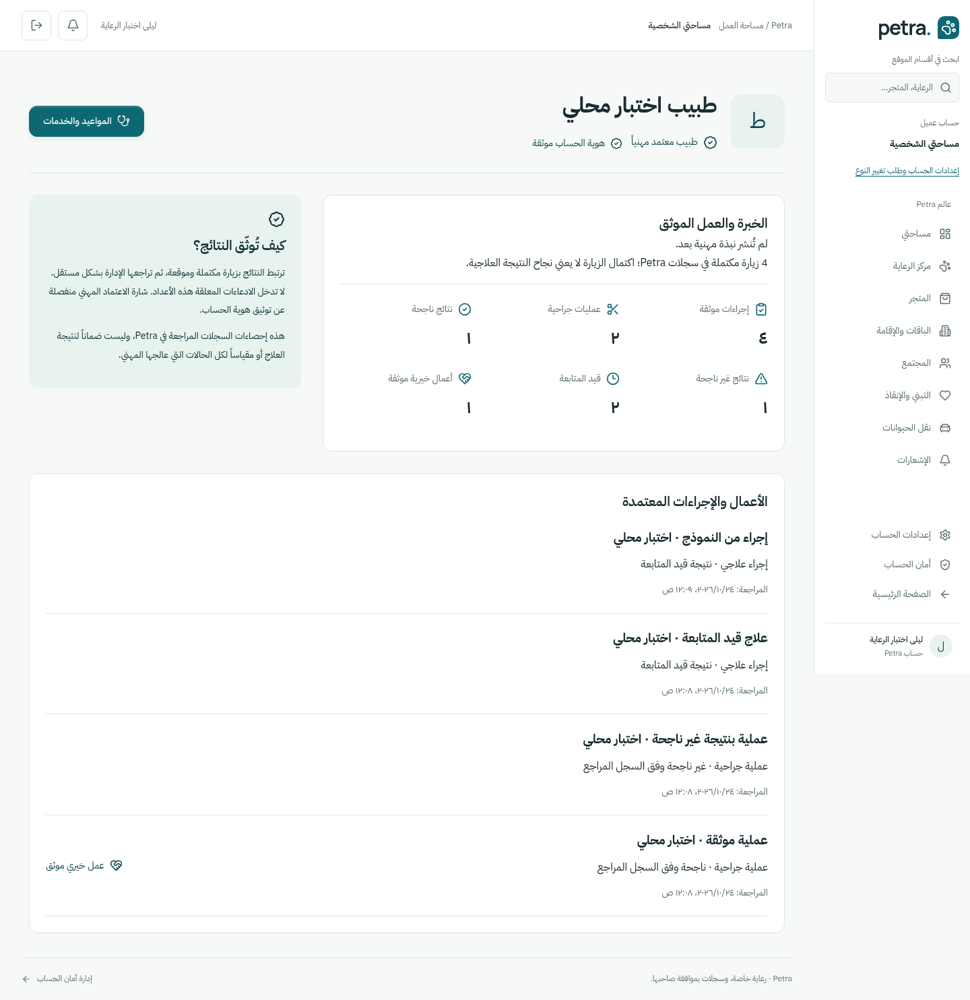

# صور Petra الفعلية — النسخة النهائية

هذه صور Chromium أصلية من موقع يعمل محلياً ببيانات اختبار اصطناعية في قاعدة معزولة، وليست مخططات تصميم أو بيانات مرضى وعملاء حقيقيين. هذه هي مجموعة التسليم النهائية.

المصدر: [`b0efa4b5`](https://github.com/xmohemnx/pet/commit/b0efa4b5e38ae81eaf893adaea7d18eaf7786195)؛ شجرة المصدر `6278760fdffe2ab90d6d9985e2dffcd56bc7b1ee`. [بيان الالتقاط](manifest.json) و[الأبعاد والبصمات](artifacts.json). اختُبرت أيضاً عروض 320 و768 بكسل دون تجاوز أفقي؛ الصور المحفوظة بعرضي1440 و390 بكسل. البنر يستخدم صورة هوية مفهومية موجودة في المشروع، وليس حالة طبية أو إعلاناً فعلياً لعميل. التواريخ والأسماء والنتائج اختبارية؛ ليست إثباتاً لنشر عام أو نتائج علاج حقيقية.

| الواجهة                                 | الحاسوب                                  | الهاتف                                  |
| --------------------------------------- | ---------------------------------------- | --------------------------------------- |
| داشبورد العميل والبنر المنشور           | [الصورة](customer-1440.png)              | [الصورة](customer-390.png)              |
| داشبورد الطبيب وزياراته                 | [الصورة](doctor-1440.png)                | [الصورة](doctor-390.png)                |
| داشبورد العيادة                         | [الصورة](clinic-1440.png)                | [الصورة](clinic-390.png)                |
| داشبورد السائق ورحلته الجارية           | [الصورة](driver-1440.png)                | [الصورة](driver-390.png)                |
| داشبورد مدير المنصة                     | [الصورة](admin-1440.png)                 | [الصورة](admin-390.png)                 |
| إدارة البنرات والتوثيق والنتائج         | [الصورة](admin-control-1440.png)         | [الصورة](admin-control-390.png)         |
| طلبات التوثيق والنتائج قبل قرار الإدارة | [الصورة](admin-review-pending-1440.png)  | [الصورة](admin-review-pending-390.png)  |
| إدارة متجر العيادة ومخازنها             | [الصورة](clinic-store-1440.png)          | [الصورة](clinic-store-390.png)          |
| توثيق هوية حساب العميل                  | [الصورة](verification-1440.png)          | [الصورة](verification-390.png)          |
| الملف المهني للطبيب                     | [الصورة](doctor-profile-1440.png)        | [الصورة](doctor-profile-390.png)        |
| الملف المهني للعيادة                    | [الصورة](clinic-profile-1440.png)        | [الصورة](clinic-profile-390.png)        |
| نموذج توثيق إجراء مهني                  | [الصورة](portfolio-form-1440.png)        | [الصورة](portfolio-form-390.png)        |
| سجل تقارير الطبيب بعد الحفظ             | [الصورة](portfolio-editor-1440.png)      | [الصورة](portfolio-editor-390.png)      |
| أقسام المتجر للعميل                     | [الصورة](departments-1440.png)           | [الصورة](departments-390.png)           |
| واجهة متجر عيادة واحدة للعميل           | [الصورة](clinic-customer-store-1440.png) | [الصورة](clinic-customer-store-390.png) |

