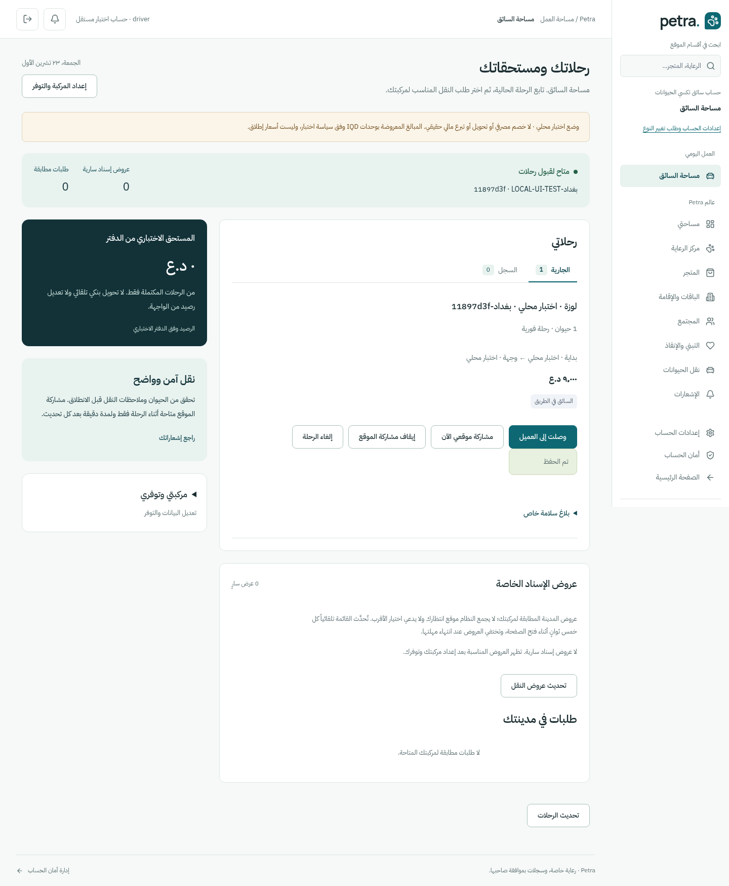
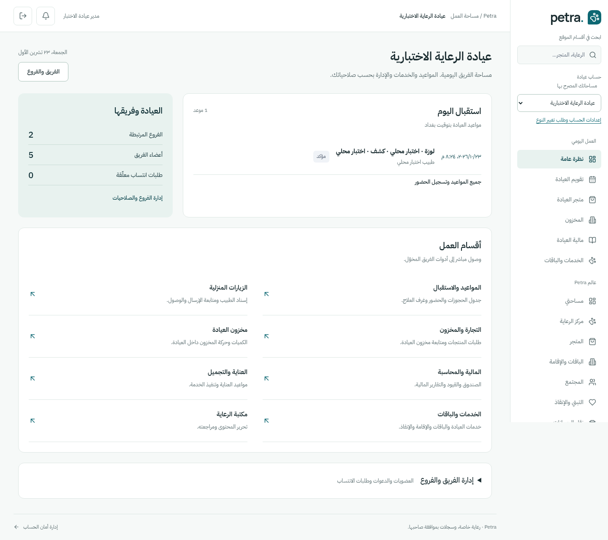
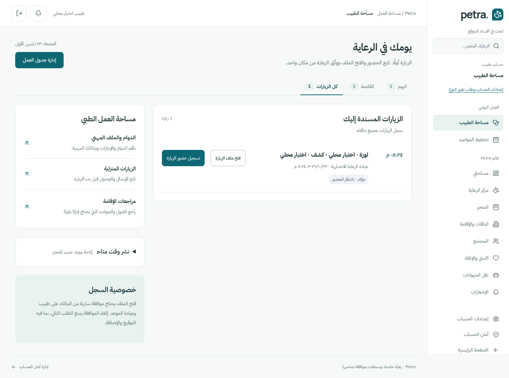
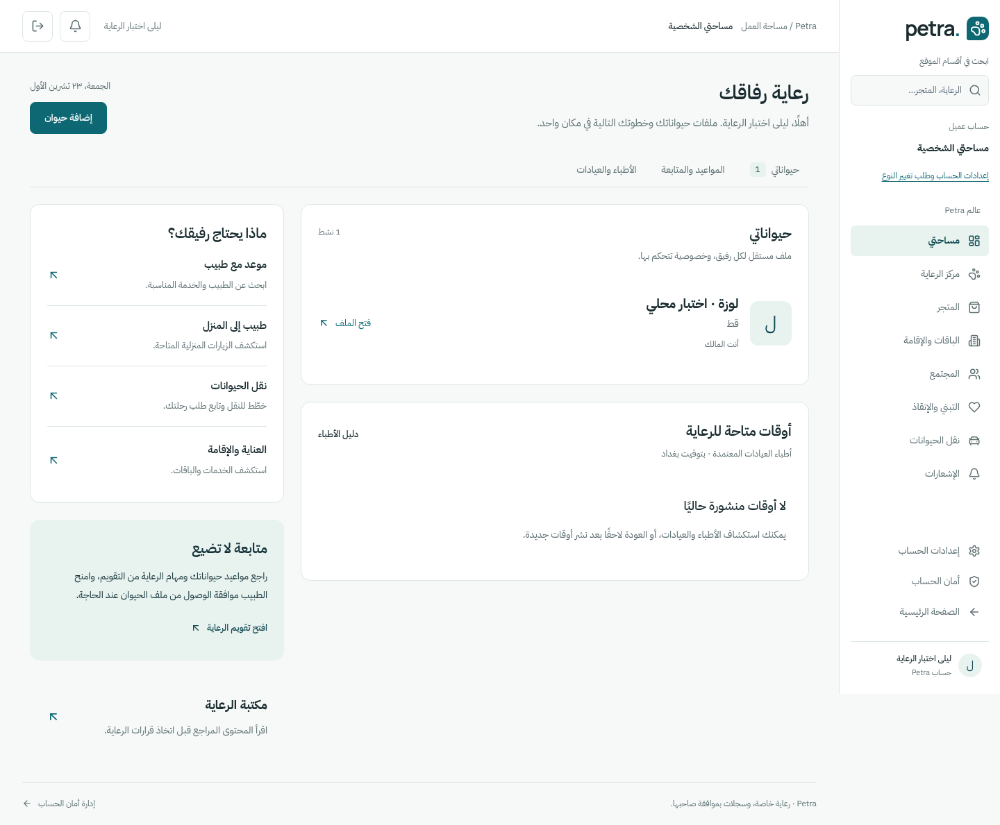

> هذه صور الدورة الأولى قبل تصحيح ملاحظات المراجعة. [الصور النهائية الأحدث](../224086c2/README.md).

# صور واجهات الحسابات الأربع

لقطات Chromium فعلية من الموقع العامل محليًا، وليست تصاميم مولّدة. مصدر الواجهات `0d3b531b4eaa0e7270cf633c1bd022d2a6fa2c72`. البيانات والحسابات ومواعيد الرعاية والرحلات اصطناعية موسومة للاختبار في قاعدة E2E مؤقتة. لا تدل الصور على نشر عام أو معاملات مالية حقيقية.

كل صورة من أعلى المستند وبكامل الصفحة، بعرض390 للهاتف و1440 للحاسوب. الشريط الثابت للهاتف يظهر في موضع نافذة الالتقاط؛ يمكن تمرير الصفحة طبيعيًا للوصول إلى محتواها. فُحص عدم التجاوز أيضًا عند320 و768. [manifest](manifest.json) و[البصمات والأبعاد](artifacts.json) يثبتان المصدر والملفات.

## السائق — رحلة جارية

[الهاتف](driver-390.png) · [الحاسوب](driver-1440.png)

## العيادة — استقبال اليوم وأقسام العمل

[الهاتف](clinic-390.png) · [الحاسوب](clinic-1440.png)

## الطبيب — الزيارات المسندة

[الهاتف](doctor-390.png) · [الحاسوب](doctor-1440.png)

## العميل — ملف الحيوان وخدمات الرعاية

[الهاتف](customer-390.png) · [الحاسوب](customer-1440.png)

## حالات البدء والإعداد

| الحالة                        | الهاتف                               | الحاسوب                                |
| ----------------------------- | ------------------------------------ | -------------------------------------- |
| عميل دون حيوانات              | [390](customer-empty-390.png)        | [1440](customer-empty-1440.png)        |
| طبيب دون زيارات اليوم         | [390](doctor-empty-390.png)          | [1440](doctor-empty-1440.png)          |
| نشر وقت الطبيب مفتوح          | [390](doctor-publisher-390.png)      | [1440](doctor-publisher-1440.png)      |
| جدول عيادة فارغ               | [390](clinic-empty-390.png)          | [1440](clinic-empty-1440.png)          |
| إدارة الفريق والفروع مفتوحة   | [390](clinic-administration-390.png) | [1440](clinic-administration-1440.png) |
| سائق قبل إعداد المركبة        | [390](driver-empty-390.png)          | [1440](driver-empty-1440.png)          |
| إعداد المركبة مفتوح بعد الحفظ | [390](driver-configuration-390.png)  | [1440](driver-configuration-1440.png)  |

الصورة تعرض حالة الحساب لحظة الالتقاط؛ لا تضاف حيوانات أو حجوزات وهمية إلى حساب المستخدم لملء الفراغ. تبقى إعدادات النوع والدخول والحذف متاحة في مساراتها الحقيقية. [تقرير التنفيذ والتحقق](../../../audits/WORKSPACES_RELEASE.md).
